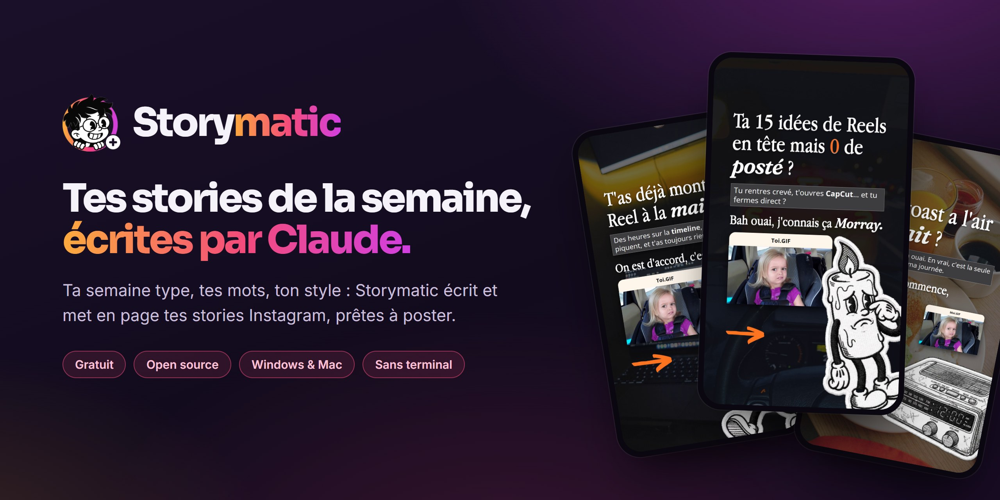
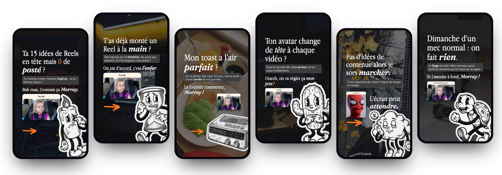
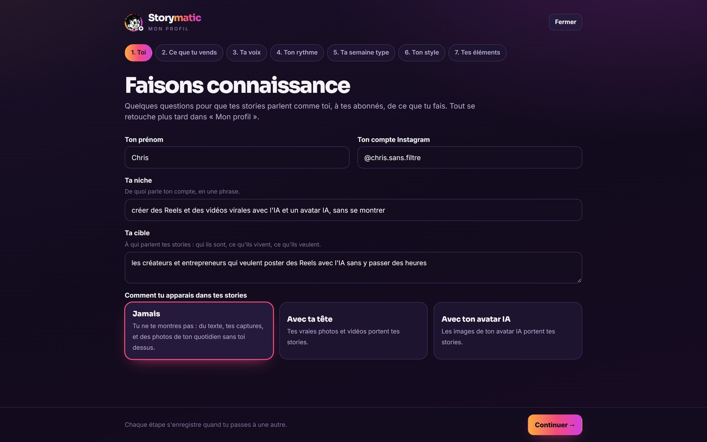
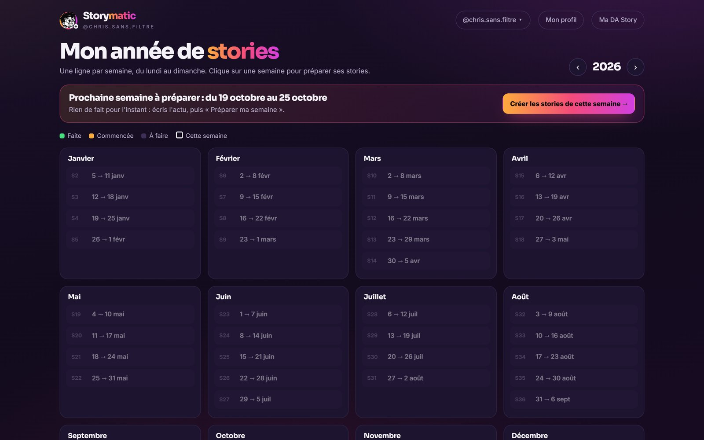
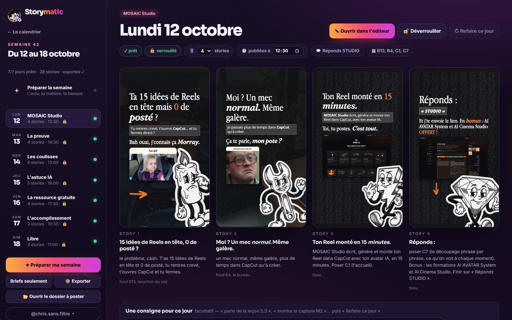
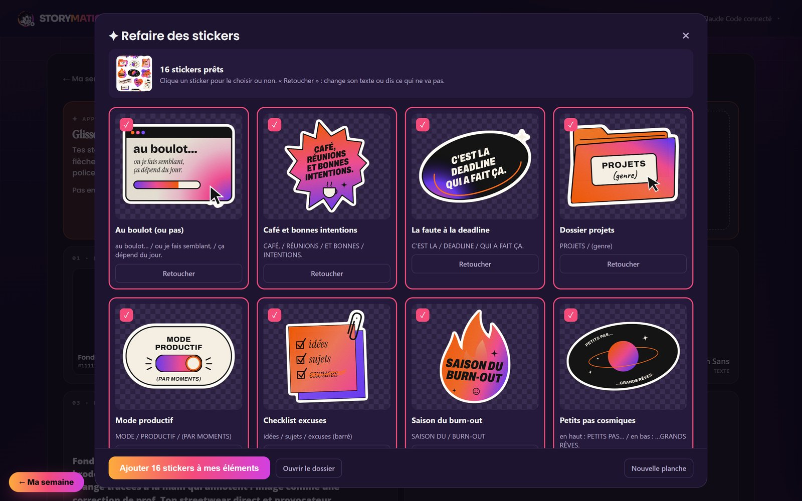
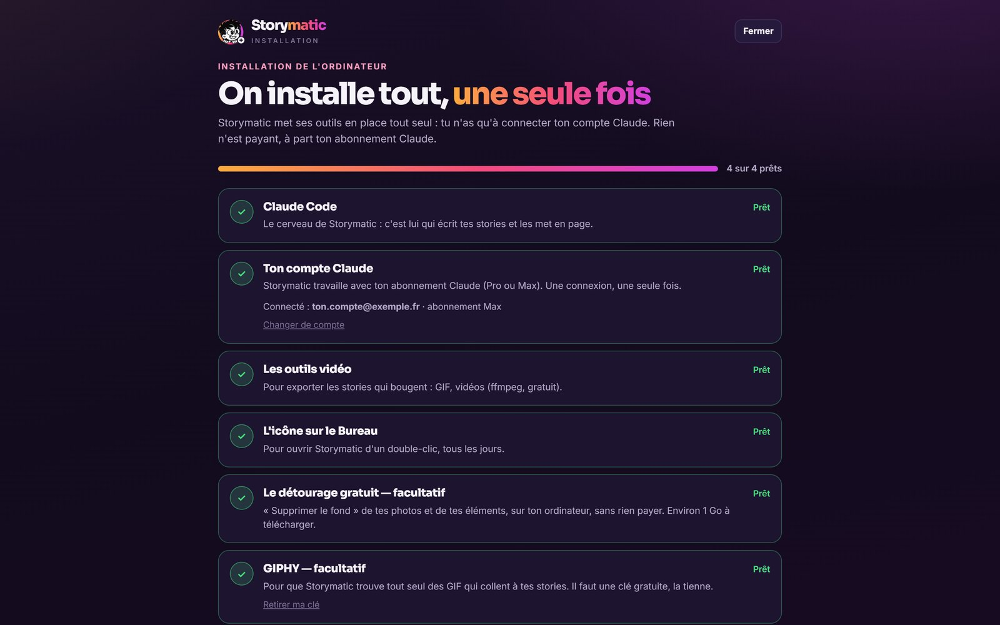

  

  
  
  

  <b>Tu réponds à quelques questions. Chaque semaine, Claude écrit et met en page tes stories Instagram — 
  avec tes mots, dans ton style, prêtes à poster.</b>

  

---

## Comment ça marche

### 1. Faisons connaissance
Ta niche, ta cible, ce que tu vends, ta façon de parler, ton rythme. Storymatic te propose ta **semaine type** : un rôle par
jour (vendre, prouver, créer du lien, apprendre, donner), que tu retouches comme tu veux.

### 2. Ton année, semaine par semaine
Le calendrier te montre ce qui est fait, ce qui est commencé, et la prochaine semaine à préparer.

### 3. Ta semaine, écrite par Claude
Tu écris l'actu de ta semaine et tu déposes ta matière (un message de client, des stats, des captures, des vidéos).
Claude écrit le brief de chaque jour, puis les stories, **avec tes mots** et **à ton style** — et t'explique chacune.
Tu retouches ce que tu veux, puis tu exportes : PNG ou MP4, le guide pour poser tes stickers Instagram, et le programme
de la semaine.

### 4. Ton style, tes éléments
**Ma DA Story** garde tes couleurs, tes polices, tes patchs et tes GIF. « Apprendre mon style » le tire de tes anciennes
stories. Et **« Refaire des stickers »** : tu déposes une image de stickers qui te plaît, Claude les redessine **en français**,
en PNG transparents, prêts pour tes stories.

**Et aussi :** plusieurs profils (un par compte Instagram), des GIF trouvés tout seuls sur GIPHY, le détourage gratuit
de tes photos.

---

## Installer Storymatic (sans terminal)

Il te faut seulement **un abonnement Claude** (Pro ou Max — [claude.ai](https://claude.ai)). Tout le reste, Storymatic
l'installe lui-même.

1. Dans **[Releases](https://github.com/chrissansfiltre/storymatic/releases/latest)**, télécharge le zip de ton ordinateur :
   `Storymatic-Windows_….zip` ou `Storymatic-Mac_….zip`.
2. **Décompresse-le en entier** (clic droit › Extraire tout, sur Windows ; double-clic sur Mac), là où tu veux le garder.
3. Double-clic sur **`OUVRIR STORYMATIC`** :
   - **Windows** : `OUVRIR STORYMATIC.vbs`. Si Windows affiche « Windows a protégé votre ordinateur » : « Informations
     complémentaires » › « Exécuter quand même ».
   - **Mac** : `OUVRIR STORYMATIC.command`. La toute première fois, macOS le bloque (« développeur non identifié ») :
     Réglages Système › Confidentialité et sécurité › « Ouvrir quand même ». Une seule fois.
4. La page **Installation** fait le reste : **« Tout installer »** (Claude Code, les outils vidéo, l'icône du Bureau —
   gratuits, depuis leurs sites officiels), puis **« Se connecter à Claude »**.
   En facultatif : le détourage gratuit (≈ 1 Go) et ta clé GIPHY gratuite.
5. Ensuite, l'icône **Storymatic** du Bureau suffit.

Le zip contient Node.js (le moteur de Storymatic, licence MIT) : rien à installer avant. La page Installation se retrouve
dans le menu à ton nom (« Installation de l'ordinateur »), par exemple pour changer de compte Claude.

---

## Questions

**C'est vraiment gratuit ?** Oui. Storymatic ne génère aucune image par une IA payante : Claude écrit et met en page avec
ton abonnement Claude, les images sont **les tiennes** (tes photos, tes captures, tes vidéos), les GIF viennent de GIPHY.

**Mes données partent où ?** Nulle part : tout vit dans le dossier de Storymatic, sur ton ordinateur. Seuls Claude (pour
écrire) et GIPHY (pour chercher un GIF) reçoivent ce dont ils ont besoin.

**Je gère plusieurs comptes Instagram ?** Le menu à ton nom (en haut du calendrier) passe d'un profil à l'autre ou en crée
un nouveau : chacun a sa semaine type, sa DA, ses captures, ses vidéos et ses exports.

**Les GIF, j'ai le droit ?** Les GIF de GIPHY ont leurs propres droits (souvent des films et des séries) : à toi de juger
ce que tu publies.

---

<b>Pour les développeurs</b>

- Node.js 20 ou plus, puis `node serveur.js` dans ce dossier et <http://127.0.0.1:4351> (`--port=4352` pour un autre
  port) — la même page Installation s'occupe du reste.
- Fabriquer les zips : `node OUTILS/release/fabriquer.js` (ils sortent dans `_RELEASES/`).
- Tes données (jamais dans Git, voir `.gitignore`) : `MON-PROFIL/`, `PROJETS/`, `IDENTITES/`, `MES CAPTURES/`,
  `MES VIDEOS/`, `MES STICKERS/`, `GIFS/`, `A POSTER/` ; les outils installés vont dans `MOTEUR/`.
- Le fonctionnement interne est décrit dans [CLAUDE.md](CLAUDE.md).

## Licence

MIT — voir [LICENSE](LICENSE). Fait par [@chris.sans.filtre](https://www.instagram.com/chris.sans.filtre/).
